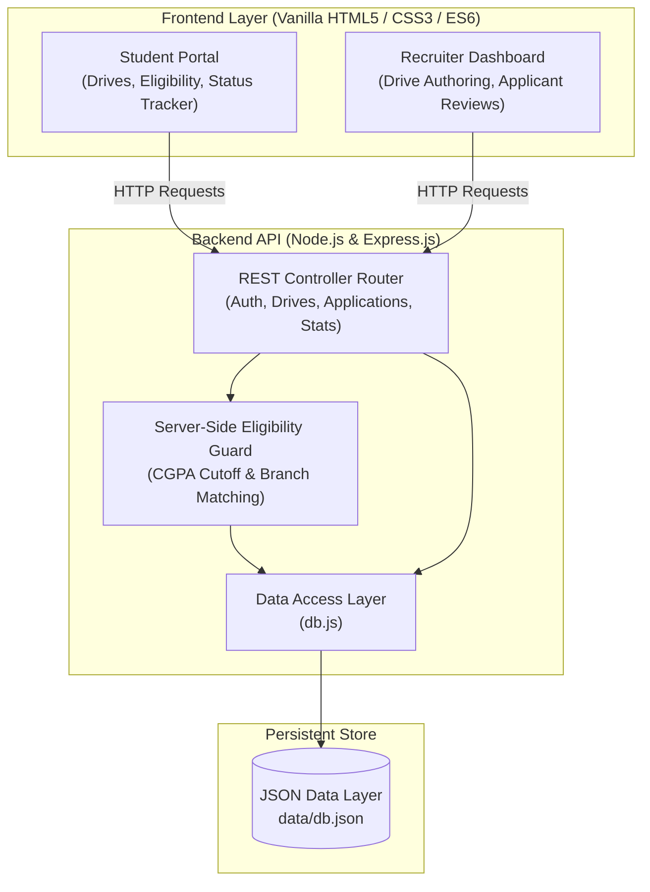

# 🎓 Campus Placement Management System

[](https://nodejs.org)
[](https://expressjs.com)
[](https://developer.mozilla.org/en-US/docs/Web/JavaScript)
[](https://restfulapi.net/)

> **A full-stack web application for managing campus placements, job drives, and student applications with server-side eligibility verification.**

---

## 📌 Project Overview

The **Campus Placement Management System** is a unified, full-stack recruitment portal designed to streamline campus hiring drives. It bridges students, corporate recruiters, and placement officers by automating eligibility filtering, job applications, and recruitment lifecycle tracking.

The system features:
- **Server-Side Eligibility Engine:** Enforces minimum CGPA and qualifying branch constraints directly in the backend to eliminate ineligible submissions.
- **Student Dashboard:** Real-time discovery of qualifying drives, duplicate-application prevention, and instant application progress tracking.
- **Corporate Recruiter Portal:** Job drive authoring, applicant management, and status progression (`Applied` → `Shortlisted` → `Selected` / `Rejected`).
- **Live System Analytics:** Summary metrics detailing active drives, applicant volumes, and placement rates.

---

## 🏛️ System Architecture



---

## ✨ Key Features

1. **Student Registration & Authentication:**
   - Account creation with degree branch and academic CGPA.
   - Session management and role-based view routing.

2. **Automated Eligibility Filtering:**
   - Filters job listings server-side so students only see drives they qualify for.
   - Rejects ineligible applications with `403 Forbidden` if submitted via direct API calls.

3. **Application Lifecycle Tracking:**
   - Visual status progression: `Applied` ➔ `Shortlisted` ➔ `Selected` / `Rejected`.
   - Prevents duplicate applications with `409 Conflict` checks.

4. **Recruiter Drive Management:**
   - Post comprehensive recruitment drives with role title, compensation package, CGPA cutoffs, eligible branches, and deadlines.
   - Review applicant profiles per drive with one-click status transitions.

5. **Instant Demo Accounts:**
   - Pre-seeded test accounts for instant evaluation:
     - **Student:** `ananya@vit.edu` / `pass123` (CGPA: 8.7, CSE)
     - **Recruiter:** `hr@tcs.com` / `pass123` (TCS HR)

---

## 📡 REST API Reference

| Method | Endpoint | Description |
|---|---|---|
| `POST` | `/api/auth/student/login` | Authenticate student credentials |
| `POST` | `/api/auth/student/register` | Register new student profile with CGPA & branch |
| `POST` | `/api/auth/company/login` | Authenticate corporate recruiter credentials |
| `GET` | `/api/stats` | Retrieve system-wide placement summary metrics |
| `GET` | `/api/drives` | Fetch all active campus placement drives |
| `POST` | `/api/drives` | Publish a new job drive (recruiter only) |
| `GET` | `/api/drives/eligible/:studentId` | Query drives that meet student's CGPA & branch criteria |
| `POST` | `/api/applications` | Submit application with eligibility and duplicate guards |
| `GET` | `/api/applications/student/:id` | Retrieve application history for a specific student |
| `GET` | `/api/applications/drive/:id` | List candidate applicants for a specific drive |
| `PATCH` | `/api/applications/:id/status` | Update applicant status (`shortlisted`, `selected`, `rejected`) |

---

## 📂 Project Structure

```
campus-placement-management-system/
├── server.js            # Express.js REST application & route handlers
├── db.js                # JSON file data access layer (readDB / writeDB)
├── package.json         # NPM project dependencies and scripts
├── README.md            # Comprehensive documentation & architecture guide
├── data/
│   └── db.json          # Seed datastore (students, companies, drives, applications)
└── public/
    ├── index.html       # Single-page interface with role-based dashboard views
    ├── style.css        # Modern glassmorphic design system & responsive layout
    └── script.js        # API integration, DOM rendering & event handling
```

---

## 🚀 Quickstart Guide

### 1. Prerequisites
Ensure **Node.js (v18+)** and **npm** are installed.

### 2. Installation & Run
```bash
# Clone the repository
git clone https://github.com/dhruvsingh29-Driod/campus-placement-management-system.git
cd campus-placement-management-system

# Install dependencies
npm install

# Start the application server
npm start
```

Open your browser at **`http://localhost:4000`**.

---

## 🎯 Technical Interview Talking Points

### Q1: Why is eligibility checking enforced on the backend rather than only hiding cards in the UI?
> **Answer:** Client-side filtering is purely a presentation convenience. A malicious or inquisitive user could bypass the UI by sending a `POST /api/applications` request directly via `curl` or Postman. Validating CGPA and qualifying branches on the server ensures strict data integrity and guarantees ineligible students cannot submit applications regardless of client behavior.

### Q2: How does the data layer design enable seamless migration to a production database?
> **Answer:** All read/write persistence is isolated inside `db.js` (`readDB` and `writeDB`). Moving to MongoDB (Mongoose) or PostgreSQL (Prisma/TypeORM) only requires updating `db.js` without rewriting the core business logic inside Express route handlers.

### Q3: What security improvements would you implement in a production iteration?
> **Answer:** 
> 1. Hash passwords using `bcrypt` (currently stored plain for demo zero-setup simplicity).
> 2. Implement stateless `JWT` (JSON Web Token) authentication with HTTP-only cookies and role-based middleware (`verifyStudent`, `verifyCompany`).
> 3. Add input validation with libraries like `Joi` or `Zod` to sanitize requests.

---

## 📜 License
This project is licensed under the MIT License.
